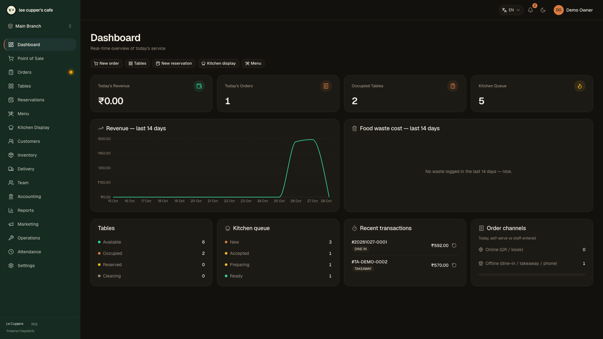
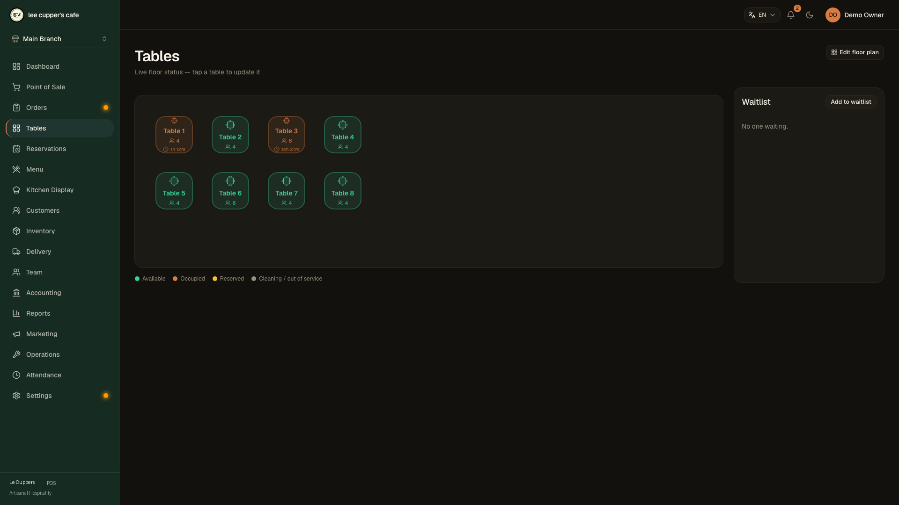
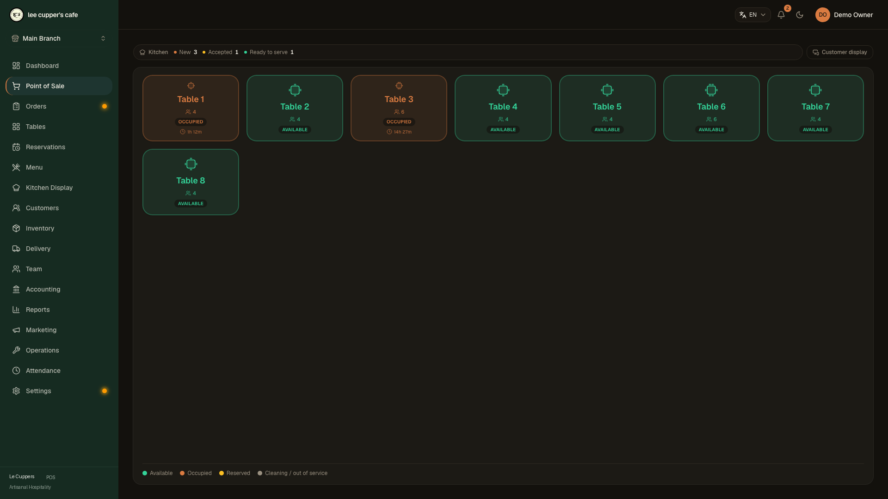
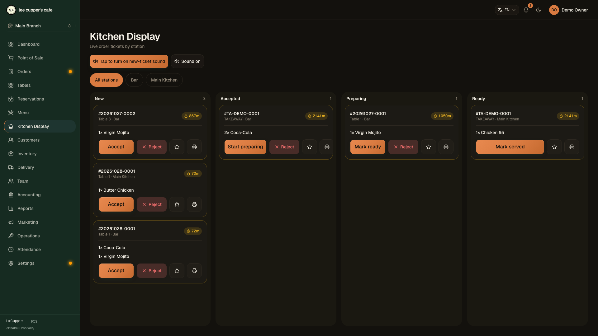

# Le Cuppers POS Tutorial

Get from zero to your first UPI-paid order in about ten minutes, then set up staff, stock and accounts.

**Contents:** [1. Start](#1-start-the-app) · [2. Sign in & set up](#2-sign-in-and-set-up) · [3. Menu, tables & customers](#3-build-your-menu-tables-and-customers) · [4. Take an order](#4-take-an-order) · [5. Get paid with UPI](#5-get-paid-with-upi) · [6. Kitchen](#6-kitchen-display) · [7. Staff & payroll](#7-staff-attendance-and-payroll) · [8. Inventory](#8-inventory) · [9. Accounting](#9-accounting) · [10. Reports](#10-reports-exports-and-scheduled-emails) · [11. The other screens](#11-the-other-screens) · [12. Connect other systems](#12-connect-other-systems)

---

## 1. Start the app

You need a machine that stays on in the restaurant (a mini PC, an old laptop, a NAS or a VPS) with Docker. The database is created for you on first start.

```bash
curl -fsSL https://raw.githubusercontent.com/Raktim94/nodedr-restaurant-pos/master/scripts/quickstart.sh | bash
```

Or from a clone:

```bash
git clone https://github.com/Raktim94/nodedr-restaurant-pos.git
cd nodedr-restaurant-pos
./install.sh
```

Open `http://<that machine's IP>:1995` from any till or tablet on the same network. On Windows use `quickstart.ps1`. On **CasaOS / ZimaOS**, install from the compose manifest in [`casaos/`](./casaos/README.md); pre-built amd64 and arm64 images are published, so nothing is compiled.

> Using it over HTTPS (a tunnel or reverse proxy)? Set `COOKIE_SECURE=true` in `.env`, or login will appear to succeed and then fail with "Unauthorized".

## 2. Sign in and set up

The first time you open the app, **Sign up** creates your restaurant and the owner account. After that, **Sign in** with the same email.

You land on the **Dashboard**: today's revenue, orders, occupied tables, kitchen queue, a 14-day revenue chart and food-waste cost.



Then open **Settings** and do these once:

1. **Restaurant**: name, currency (`INR`), timezone, logo, and your **UPI id** (see [section 5](#5-get-paid-with-upi)).
2. **This branch**: address, phone, GSTIN, **tax regime** (India GST, US Sales Tax, EU VAT or Spain IVA) and whether menu prices include tax.
3. **Staff** and **Roles**: one account per person, each with only the permissions they need.

## 3. Build your menu, tables and customers

Open each from the sidebar and press **Add**.

| Module | What to configure | Purpose |
| --- | --- | --- |
| **Menu** | Categories, items, modifier groups (size, spice, add-ons) and combos | What the POS and the QR menu sell |
| **Tables** | Floors and tables, with a printable **QR code** per table | Dine-in orders, table status, and mobile guest ordering |
| **Customers** | Name, phone, allergies, birthday | Loyalty points, gift cards and visit history |
| **Reservations** | Bookings, seating party sizes, and a live waitlist | Managing guest arrivals and schedule capacity |



## 4. Take an order

1. Open **Point of Sale**, pick a table (or choose **Takeaway** / **Delivery**).
2. Tap items. Items with options open a picker for crust, size, add-ons and variations.
3. Check the cart, then **Send to kitchen**. A ticket (KOT) goes immediately to the right station.



You do not have to take payment straight away. Tap **Back** to serve another table and come back to this bill later from **Tables** or **Orders**.

The checkout panel handles discounts, coupons, loyalty points, gift cards, tips and bill splitting. The server recalculates every amount, so the figure on the receipt is the figure that was charged.

**Orders** lists every order with its status and shows what each guest ordered, modifiers selected, and amounts paid.

## 5. Get paid with UPI

Le Cuppers POS builds a standard UPI payment link for the **exact amount due**. There is nothing to type in the customer's app, and no payment-gateway fees.

### Set up

1. Go to **Settings → Restaurant**.
2. Enter your **UPI id** (for example `yourshop@okbank`) and the **payee name** customers should see.
3. Save.

### Take a UPI payment

1. At checkout choose **UPI** as the payment method. A QR for the bill amount appears.
2. The same QR appears full-screen on the **customer display**.
3. The guest scans it with GPay, PhonePe, Paytm or any UPI app.
4. Check your UPI app or soundbox for the credit, then press **Complete payment**.

When the payment is recorded, the till plays a **payment-received chime** and the customer display shows **Thank you** and plays it too.

> The app does not read your bank's confirmation automatically. Pressing **Complete payment** is how a cashier confirms the money arrived, so always check your UPI app or soundbox first.

### The customer display

1. On a second monitor or tablet, open `http://<server>:1995/customer-display`.
2. **Click or tap once anywhere** on that page. Browsers block sound until the page is touched.
3. Open it in the **same browser** as the POS, in another window. It follows the till live.

It shows a welcome screen when idle, the running order and total while you ring up, the UPI QR at payment, and a thank-you once paid.

## 6. Kitchen display

Open **Kitchen Display** (`/kds`) on a screen in the kitchen. Tickets appear in real time with a timer that warns after 15 minutes. Accept, mark preparing, then bump a ticket when it is ready. Use priority and reprint for rush orders and lost tickets.



## 7. Staff, attendance and payroll

### Attendance

Staff **clock in and out** from **Attendance** and can request leave. Managers see everyone's hours and can correct a missed punch.

### Team: shifts, leave, payroll, performance

**Team** provides four tabs for operations:

| Tab | Function |
| --- | --- |
| **Schedule** | Weekly shifts per person. Clashing (overlapping) shifts are warned about. |
| **Leave** | Managers approve or reject requests. Approved **unpaid** leave is deducted from payroll. |
| **Payroll** | Set each person's pay (monthly or hourly), then run payroll for a period. |
| **Performance** | Sales and orders per staff member. |

**Run payroll**:

1. Under **Pay rates**, set each person to Monthly or Hourly and save.
2. Pick the period and press **Run payroll**. The draft is calculated from **clocked hours**, less approved unpaid leave.
3. Tips collected in the period are **split by hours worked**.
4. Review the lines, then **finalize**. Finalized runs feed the profit & loss report.

## 8. Inventory

**Inventory** tracks ingredients, with stock, reorder level and weighted-average cost.

| Screen | Functionality |
| --- | --- |
| **Procurement** | Requests, quotations, invoices and payments to suppliers |
| **Purchase orders** | Order stock, then receive it with batch and expiry tracking |
| **Suppliers** | Contact directories and payment terms |
| **Waste** | Log spoilage, deducted first-in-first-out at the real batch cost |
| **Transfers** | Move stock between branches |

- **Recipes** link menu items to ingredients. Stock deducts at checkout, and a shortfall never blocks a sale.
- **Transfers** need at least two branches. Choose the ingredient, quantity and destination, then **Transfer**. The source is reduced first-in-first-out, and the destination gets a new batch at the same cost.

## 9. Accounting

Open **Accounting** for integrated financial operations:

| Tab | Capabilities |
| --- | --- |
| **Expenses** | Record spending. Mark "paid from till" to count it in cash close. |
| **Cash close** | Count the drawer at night. Shows expected cash and the variance. |
| **Profit & loss** | Net sales − expenses − payroll, for any date range. |
| **Balance sheet** | A snapshot of cash, inventory, unpaid supplier invoices and gift-card balances. |
| **Budgets** | A monthly budget per expense category, with spending against it. |
| **Bank** | Import a bank statement CSV and match it to expenses. |
| **GST** | Tax summary by rate (India GST, Spain IVA, etc.). |
| **Branches** | Sales, open orders, low stock and inventory value across locations. |

**Bank reconciliation**: download your statement as **CSV** (a date, a description and either one `amount` column, negative for money out, or `debit` and `credit` columns). In **Accounting → Bank**, choose **Import bank statement**. Money-out lines are auto-matched to expenses with the same amount within 5 days. Press **Match** to pick one yourself or **Ignore** for lines you do not track. Importing the same file twice is safe.

## 10. Reports, exports and scheduled emails

**Reports** provides 18 operational reports: daily sales, sales by item, peak hours, food cost and margins, retention, tax, waste and more. Print them, or export as **Excel**, **PDF** or **CSV** (needs the `data.export` permission).

### Email a report on a schedule

1. Set `SMTP_URL` and `SMTP_FROM` on the server (any standard SMTP provider works).
2. Open **Reports** and scroll to **Email this report on a schedule**.
3. Choose daily, weekly or monthly, a format and the recipients.

Reports go out at 06:00 branch time: daily covers yesterday, weekly goes on Monday for the previous 7 days, and monthly goes on the 1st for the previous month. **Send now** tests a schedule immediately.

## 11. Additional Operational Features

| Area | Features |
| --- | --- |
| **Marketing** | Coupons, happy-hour pricing and customer campaigns. |
| **Delivery** | Delivery zones and the pickup-to-delivered status of delivery orders. |
| **Operations** | SOP documents, maintenance schedules, recipes, and contracts. Attach PDFs, images, text, Word or Excel files (5 MB each, up to 10 per document). |
| **Settings → Audit log** | Immutable trail of user actions, timestamps, and entities changed. |
| **Settings → Backup** | Automated local and S3-compatible cloud backups, manual exports, and verified database restoration. |
| **Settings → Security** | Two-factor sign-in (TOTP) and emergency recovery codes. |
| **Settings → API keys & Webhooks** | Manage integration credentials and subscribe to real-time events. |
| **Settings → Updates** | In-app version checks and migration notifications. |

## 12. Connect other systems

Le Cuppers POS includes a REST API (`/api/v1`, OpenAPI docs at `/api/docs`), API keys, webhooks and an MCP server. See [docs/integrations-api.md](docs/integrations-api.md).

## Troubleshooting

| Problem | Fix |
| --- | --- |
| Login works, then "Unauthorized" | Using HTTPS? Set `COOKIE_SECURE=true`. Plain HTTP? Keep it `false`. |
| No UPI QR at checkout | Add a UPI id in **Settings → Restaurant** and save. |
| Customer display is silent | Tap the display page once so the browser allows sound. |
| Customer display does not follow the till | Open it in the **same browser profile** as the POS. |
| "Email is not set up" | Set `SMTP_URL` and `SMTP_FROM`, then restart the backend. |
| Transfer says unit mismatch | The destination stocks that ingredient in a different unit. Align the unit first. |

## Backups

Everything lives in your Postgres volume. Use **Settings → Backup** for scheduled backups, and test a restore before you need one.

Questions or bugs: [open an issue](https://github.com/Raktim94/nodedr-restaurant-pos/issues).
